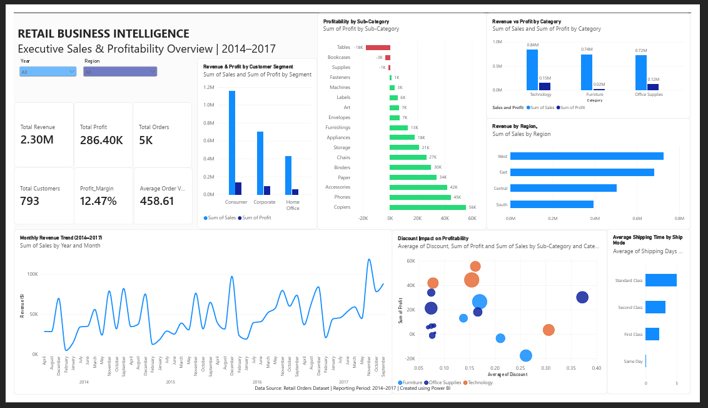

# Retail Business Intelligence

An end-to-end Retail Business Intelligence project using **Python, MySQL, SQL, and Power BI** to analyze retail sales, profitability, customer segments, regional performance, and business trends.

## Project Overview

This project transforms raw retail transaction data into meaningful business insights through data cleaning, database management, SQL analysis, and interactive dashboard development.

The objective is to identify sales trends, evaluate profitability, understand customer purchasing patterns, and support data-driven business decisions.

## Tools & Technologies

- **Python:** Pandas, NumPy, Jupyter Notebook
- **Database:** MySQL
- **Query Language:** SQL
- **Data Visualization:** Power BI
- **Development Environment:** VS Code

## Project Workflow

1. **Data Cleaning & Preparation**
   - Imported and inspected the raw retail dataset.
   - Handled data types and date conversions.
   - Created additional analytical columns.
   - Prepared the cleaned dataset for database integration.

2. **Database Management**
   - Created a MySQL database and retail orders table.
   - Imported 9,994 cleaned records.
   - Validated data and calculated key business metrics.

3. **SQL Business Analysis**
   - Annual sales and profit performance.
   - Regional sales performance.
   - Category and sub-category profitability.
   - Discount and profitability analysis.
   - Customer segment analysis.
   - Monthly sales trends.
   - Shipping mode analysis.

4. **Power BI Dashboard**
   - Developed an interactive executive dashboard.
   - Created KPI cards and business performance visuals.
   - Added Year and Region slicers for interactive filtering.

## Key Business Insights

- **Total Revenue:** $2.30M
- **Total Profit:** $286.40K
- **Total Orders:** 5,009
- **Total Customers:** 793
- **Overall Profit Margin:** 12.47%

Additional findings:

- The West region generated the highest revenue and profit.
- Technology was the most profitable product category.
- Furniture had a relatively low profit margin.
- Tables recorded the largest sub-category loss.
- Home Office customers had the highest profit margin among customer segments.
- November 2017 recorded the highest monthly revenue.

## Project Structure

```text
Retail-Business-Intelligence/
│
├── data/
│   ├── raw/
│   └── processed/
│
├── notebooks/
│   └── 01_data_inspection.ipynb
│
├── Retail_Business_Intelligence.pbix
├── requirements.txt
├── .gitignore
└── README.md
```

## Dashboard

The interactive Power BI dashboard provides an overview of retail sales, profitability, regional performance, product categories, customer segments, and shipping trends.




## Business Insights Report

Detailed analysis of sales performance, regional trends, customer segments, product profitability, discount patterns, and business recommendations.

[View Business Insights Report](reports/Retail_Business_Insights_Report.md)


## Skills Demonstrated

- Data Cleaning and Preprocessing
- Exploratory Data Analysis (EDA)
- SQL Queries and Business Analysis
- MySQL Database Management
- DAX Measures
- Power BI Dashboard Development
- Business Intelligence and Data Storytelling

## Author

**Sanu Abraham**

Computer Science Engineering Graduate | Interested in Data Analytics, Business Intelligence, Data Science, and AI.

[GitHub Profile](https://github.com/ftsanu)

---

*This project was developed for learning, portfolio development, and practical application of data analytics techniques.*
